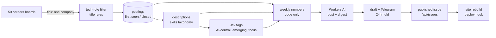

# 📡 CareerRadar

Careers pages say where companies are putting their money before any announcement does. CareerRadar watches the careers
pages of **the 50 companies shaping AI and future tech** (frontier labs, hyperscalers, chip makers, AI infra, dev tools,
robotics), keeps every **tech** role it sees, and turns the changes into a short weekly post: which skills are rising, how
the role mix shifts, which new kinds of roles appear, where AI is central.

Runs locally (SQLite, a cron or launchd tick) or as a **Cloudflare Python Worker** (D1, cron triggers, Workers AI), from
the same code. Built on [RadarKit](https://github.com/farhaduneci/RadarKit).

## ⚙️ How it works



- 🧭 **Default watch list**: [`careerradar/data/companies.json`](careerradar/data/companies.json), 50 companies with
  verified public boards, chosen in [`docs/research/top-companies.md`](docs/research/top-companies.md). Bring your own
  with `companies.json`.
- 🛠️ **Tech roles only**: titles are classified by [`data/tech_roles.json`](careerradar/data/tech_roles.json) into
  functions (AI research, ML & AI engineering, forward deployed, infrastructure, data, security, silicon, robotics,
  frontend, software) and seniority. Everything else is never stored.
- 🔍 **Skills** come from [`data/taxonomy.json`](careerradar/data/taxonomy.json), regexes over the description with each
  company's boilerplate (about-us, benefits, pay text) learned and stripped first. Edit it and run `reskill`.
- 🧠 **Jev** ([TypeSafe](https://typesafe.ai)) tags each described role: is AI the core of the job, is this a new kind of
  role, what is its focus. Capped per tick and per day.
- 📏 **Honest numbers**: a company's first crawl is a silent baseline, week-over-week figures only compare companies
  tracked in both weeks, and big boards are sampled (shares need a sample, not every posting). A crawl that fails or
  shrinks by half closes nothing.
- ✍️ **AI writes, code counts**: the writer (Workers AI) sees only the computed numbers and the rules in
  [`prompts/post.md`](careerradar/prompts/post.md).
- ⏸️ **Hold window**: each Monday's draft goes to Telegram with signed *preview*, *hold* and *publish now* links. It
  publishes itself after `publish.hold_hours` unless held. Links open a confirm page; only its button acts.

## 🚀 Local quickstart

```bash
git clone <this repo> && cd CareerRadar
python3 -m pip install -e .                 # installs RadarKit
cp config.example.json config.json          # optional overrides
python3 -m careerradar crawl --company anthropic
python3 -m careerradar status
python3 -m careerradar issue stats --week 2026-W43   # the numbers a post is written from
```

Environment: `TELEGRAM_BOT_TOKEN`, `TELEGRAM_CHAT_ID` (notify), `TYPESAFE_API_KEY` (Jev), `CLOUDFLARE_ACCOUNT_ID`,
`CLOUDFLARE_API_TOKEN` (Workers AI over REST), `LINK_SECRET` (signs hold/publish links).

## 🧰 Commands

| Command | Does |
|---|---|
| `tick [-n N]` | what one cron firing does: publish due drafts, build last week's issue when due, else crawl the next company and Jev-tag |
| `crawl [--company SLUG]` | crawl now, due or not |
| `tag` | Jev-tag described postings (capped) |
| `reskill [--company SLUG]` | re-match skills on stored descriptions after a taxonomy edit |
| `issue build\|stats\|show\|publish\|hold [--week YYYY-Www] [--quiet]` | the weekly issue |
| `export DIR` | published issues as JSON files, for a site built from files |
| `status` / `health` | per-company crawl state / what looks broken |
| `serve [--port]` | the read API and signed links on localhost |

## ☁️ Cloudflare

```bash
cp worker/wrangler.example.jsonc worker/wrangler.jsonc
npx wrangler d1 create careerradar                      # put the id in worker/wrangler.jsonc
for s in TELEGRAM_BOT_TOKEN TELEGRAM_CHAT_ID TYPESAFE_API_KEY LINK_SECRET SITE_DEPLOY_HOOK; do npx wrangler secret put $s -c worker/wrangler.jsonc; done
python3 scripts/bundle.py                               # careerradar + radarkit -> worker/src
cd worker && uv run pywrangler deploy
```

A cron fires a tick every 10 minutes; at one company per tick the full list is crawled several times a day. The
Workers **Paid** plan is needed: Google, Apple, Amazon and the Workday boards take hundreds of requests and seconds of CPU
per crawl, past the free plan's 50 subrequests and 10 ms.

### 🔌 API

| Route | Returns |
|---|---|
| `GET /api/issues` | published issues: week, title, dek, date |
| `GET /api/issues/latest`, `/api/issues/<YYYY-Www>` | one published issue: post Markdown and every number behind it |
| `GET /api/health` | last tick, open postings, failing boards |

A site rebuilds from these: set its build hook as `SITE_DEPLOY_HOOK` and CareerRadar calls it on each publish.

## 🛠️ Development

```bash
python3 -m pytest -q
```

---

Built with ❤️ by Farhad ∙ Istanbul, October 2026.
